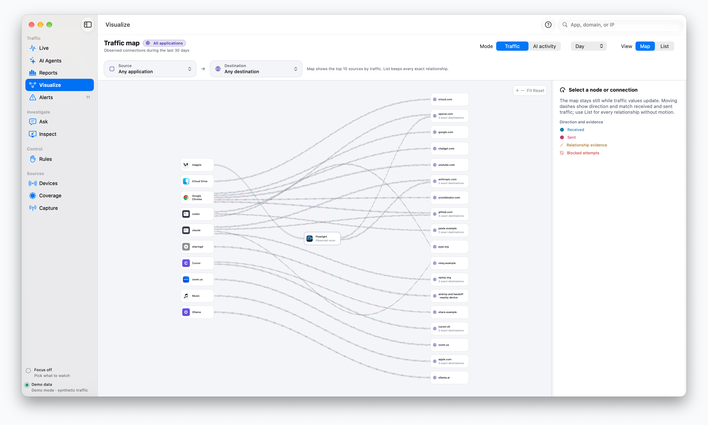
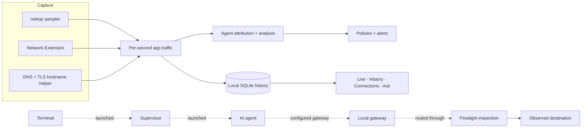
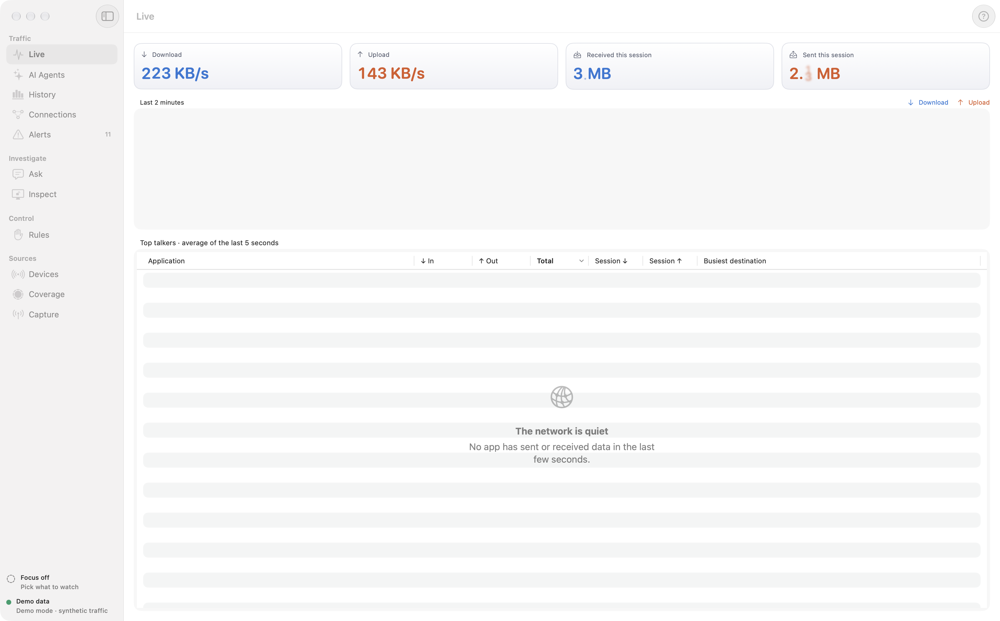
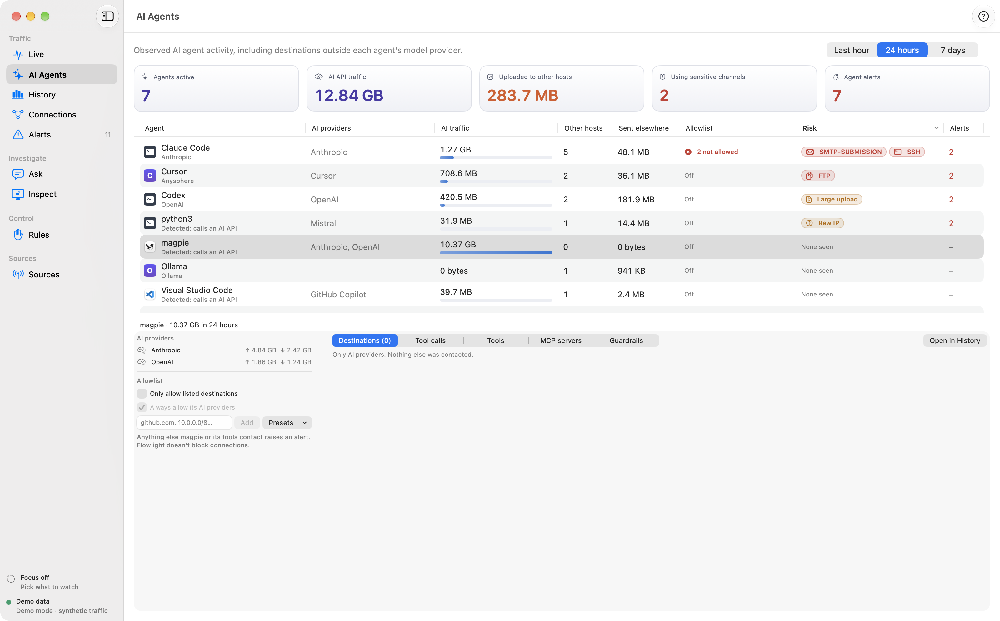
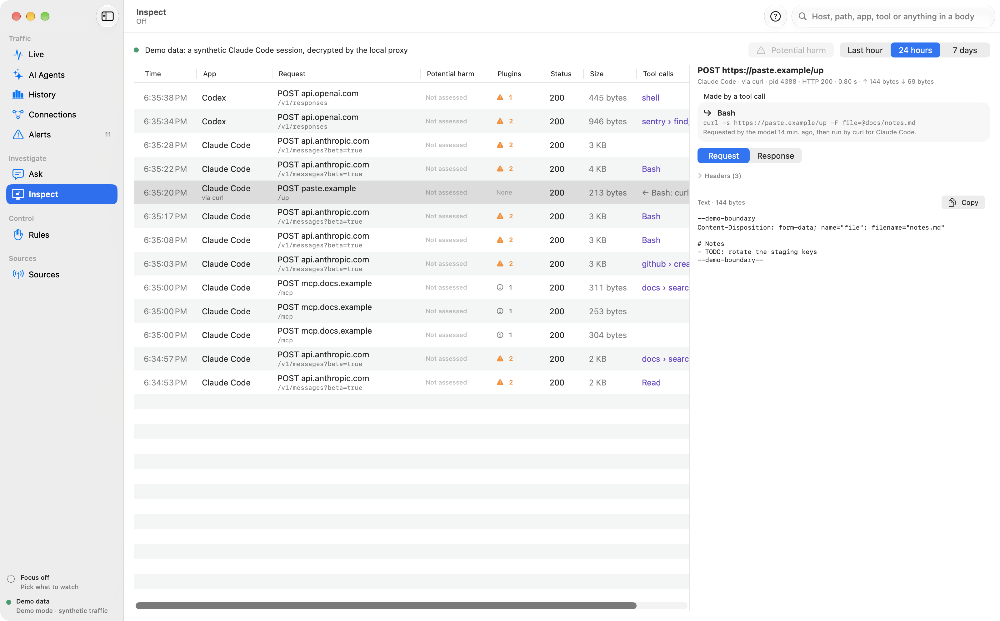
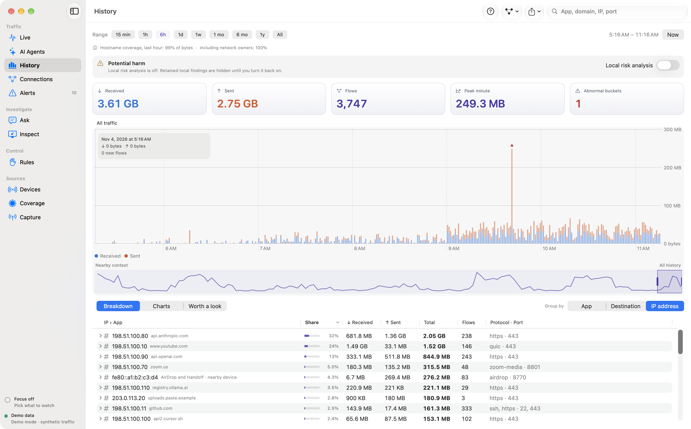
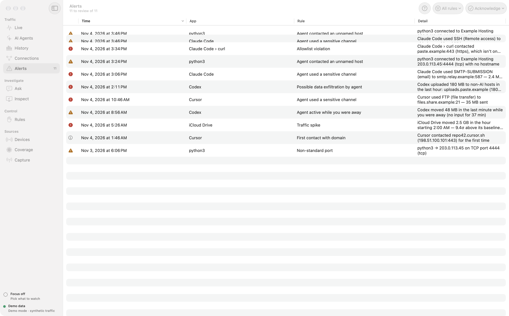

<div align="center">

<a href="https://flowlight.xinbetween.com">
  
</a>

# Flowlight

### See where every Mac app connects — especially the AI agents acting for you.

Flowlight is a native, local-first network monitor for macOS. It connects observed traffic to applications,
destinations, protocols, agent tools, MCP servers, configured gateways, and inspection routes without sending
your history to a Flowlight service.

[](https://github.com/xinbetween/flowlight/releases/latest)
[](https://github.com/xinbetween/flowlight/stargazers)
[](https://github.com/xinbetween/flowlight/actions/workflows/ci.yml)


[](LICENSE)


[**Download**](https://github.com/xinbetween/flowlight/releases/latest/download/Flowlight.dmg) ·
[Website](https://flowlight.xinbetween.com) ·
[Documentation](https://flowlight.xinbetween.com/docs/) ·
[Privacy](https://flowlight.xinbetween.com/privacy/) ·
[Threat model](https://flowlight.xinbetween.com/threat-model/)



</div>

## Is Flowlight for you?

Flowlight is for people who want a precise answer to a simple question:

> **What is this application—or the agent and tools behind it—talking to?**

It is a good fit when you want to:

- **See application traffic, not an anonymous interface total.** Flowlight attributes observed TCP and UDP activity to
  apps, command-line tools, background services, hostnames, IP owners, ports, protocols, and network channels.
- **Understand agent relationships.** It connects known agents to the tools and MCP servers they start, the local
  gateways they are configured to use, Flowlight's optional inspection proxy, and the final observed destination.
- **Turn evidence into a policy.** Rules, agent allowlists, and signed managed packs can report or refuse connections;
  every row says whether it is enforcing, waiting, reporting only, or unavailable in the current capture mode.
- **Keep the evidence on your Mac.** History lives in a local SQLite database. There is no Flowlight account, cloud,
  analytics SDK, or product telemetry.

Flowlight is a monitor and policy tool for software you choose to run. It is not a sandbox or a defence against an
attacker who already controls the Mac; the [threat model](https://flowlight.xinbetween.com/threat-model/) describes that
boundary precisely.

## Quick start

### 1. Install

With Homebrew:

```sh
brew install --cask xinbetween/tap/flowlight
```

Or download **[Flowlight.dmg](https://github.com/xinbetween/flowlight/releases/latest/download/Flowlight.dmg)**, open it,
and drag Flowlight to Applications. Releases are signed and notarized. Each
[release](https://github.com/xinbetween/flowlight/releases/latest) also includes a `.pkg` installer.

### 2. Choose how to capture

Launch Flowlight and open **Sources › Collector**:

| Source | Setup | Best for | Tradeoff |
|---|---|---|---|
| **nettop sampler** | None | Trying Flowlight immediately | Can miss a connection that opens and closes between one-second readings |
| **Network Extension** | Approve the content filter in System Settings | Every flow, exact app identity, and blocking | Only one macOS content filter can be active at a time |

The first-run **Name Your Traffic** step can install the optional hostname helper. It reads DNS answers and TLS server
names; packet bodies are not stored.

### 3. Explore safely with demo data

```sh
open /Applications/Flowlight.app --args -FLDemo YES
```

The isolated demo contains synthetic traffic, policies, alerts, AI agents, tool calls, and inspection records. It does
not read your normal Flowlight history.

## Supported AI agents

Flowlight recognizes these clients by stable application or process identity:

**Claude · Claude Code · ChatGPT · Codex · Cursor · Windsurf · Zed · GitHub Copilot · Gemini CLI · Aider · Goose ·
OpenCode · Ollama · LM Studio · Perplexity · ZCode**

It can also classify a non-browser process that contacts a known LLM API provider. That is a visibility heuristic—not a
claim that the process is autonomous or unsafe. Browsers are excluded so opening a chat website does not turn the browser
into an “agent.”

For supported agent configurations, Flowlight can name local MCP servers and show configured proxy or model-gateway
relationships. Capture-time process evidence keeps child tools such as `curl`, `git`, or `npm` attached to the agent that
started them instead of inventing relationships later from names alone.

## How it fits together



Relationship-only edges carry no duplicate byte or flow totals. In a proved
`terminal → supervisor → agent → gateway → Flowlight → destination` route, the final observed edge owns the traffic
counters once; launcher, configuration, and route edges explain how it got there.

Two capture engines feed the same storage and UI model:

| | **nettop sampler** | **Network Extension** |
|---|---|---|
| Attribution | Process and app metadata | Audit token and signing identity |
| Hostnames | DNS/TLS helper, reverse DNS, optional IP owner | SNI, HTTP host, DNS, optional IP owner |
| Short-lived flows | May be missed between samples | Observed when the connection is opened |
| Byte counts | Running-counter deltas for surviving flows | Filter statistics |
| Blocking | Observe only | Can refuse before connection establishment |

History rolls from seconds into minute, hour, and day tables so long ranges stay responsive.

## What it does

### Connections you can explain

The Connections map has ordinary Traffic and focused AI activity modes. Cards preserve exact underlying members for
History, Inspect, and Policies navigation while grouping busy graphs into readable application and destination families.
Configured gateway and proxy support legs stay distinct from observed traffic, and unrelated localhost services remain
visible.

<table>
<tr>
<td width="50%"></td>
<td width="50%"></td>
</tr>
<tr>
<td align="center"><sub>Live: application, destination, protocol, and current rate</sub></td>
<td align="center"><sub>AI Agents: providers, tools, destinations, and explainable risk</sub></td>
</tr>
</table>

### Agent tools, MCP servers, and allowlists

Flowlight walks capture-time process lineage back to the nearest proved agent. A child process appears as a tool or named
MCP server under that agent, with its own exact destinations. Per-agent allowlists can warn on anything outside the list,
or refuse it when the Network Extension is healthy. AI-provider traffic and local-network traffic remain explicit in the
policy model.

Recognized signals include sensitive protocols, unfamiliar destinations, raw-IP traffic, large uploads, and activity
while you are away. Every alert names the evidence and threshold that caused it.

### Policies that say what they can enforce

**Policies** brings together network rules, agent allowlists, managed packs, guardrails, mocks, and request rewrites. The
three network inventories are collapsible, retain their expansion state, and summarize enforcing, reporting, waiting,
and review-needed items while collapsed.

- The most specific matching rule wins; an equally specific block beats an allow.
- Rules can be permanent, temporary, session-bound, or scheduled.
- Global **Pause Blocking** and scoped allow-once actions remain visible escape hatches.
- Official advertising, cross-site tracking, and privacy/telemetry packs are signed, off by default, and require review
  before changed destinations can enforce.
- Collection endpoints can be blocked without making analytics dashboards, login, billing, or administration disappear.

### Optional HTTPS inspection

Inspection is off by default. When enabled, Flowlight runs a loopback proxy with a certificate authority created on your
Mac and records supported HTTP requests routed through it.

It can show headers, structured bodies, timing, model/tool declarations, tool calls, MCP traffic, and the request caused
by a tool call. Known credential header values are never stored. Applications with certificate pinning may reject
inspection and are not silently described as inspected.

Inspection also powers:

- **Guardrails** that remove refused tools from supported model requests or return protocol-shaped MCP errors.
- **Mock responses** for a chosen host, path, and method without sending that request to the origin.
- **Request rules and rewrites** with explicit scope and effect provenance.



### History, reports, and “Worth a look”

Choose ranges from 15 minutes through all retained history, pan or resize the native time navigator, switch among app,
destination, and IP breakdowns, and export CSV. “Worth a look” compares applications in the selected report and surfaces
unusual destination counts, unnamed hosts, generated-looking names, upload imbalance, and uncommon protocols without
labelling them malicious.

<table>
<tr>
<td width="50%"></td>
<td width="50%"></td>
</tr>
<tr>
<td align="center"><sub>History: ranges, groupings, charts, and exact drill-down</sub></td>
<td align="center"><sub>Alerts: evidence and remediation per application</sub></td>
</tr>
</table>

### Ask without handing over the database

Ask questions such as “What did Claude Code upload yesterday?” or “Which application contacted a new destination?” The
model receives a fixed set of bounded, read-only query tools—not SQL and not the history database. Flowlight executes each
query locally and shows the query and result beneath the answer.

Use an on-device model, a local Ollama/LM Studio/llama.cpp endpoint, or your own Anthropic, OpenAI, Gemini, or compatible
API key. Remote use is disclosed before the request leaves the Mac, and keys live in the login Keychain.

### Channels beyond ordinary internet traffic

Every flow records whether it used ordinary IP, peer-to-peer Wi-Fi, loopback, or a tunnel. Sources can also report camera
activity without opening a capture session or reading frames, Bluetooth connection state without pretending to know
per-app bytes, and attached USB/external-storage state without inventing throughput macOS does not expose.

### Export you control

Optional OTLP/HTTP and newline-delimited JSON exports go only to the collector you configure. Flowlight previews the exact
fields and a real payload first; authentication headers live in Keychain. HTTPS inspection bodies and headers have no
export representation and are never included.

### Also

- **Focus mode** filters every screen and menu-bar rate to chosen applications or destinations without changing storage.
- **Background mode** keeps capture running from the menu bar with the Dock icon hidden.
- **Update recovery** detects an exact app/filter build mismatch, fails open, and offers product-specific reinstall or
  restart guidance instead of claiming that enforcement is healthy.
- **108 protocols in 13 families** cover web, email, transfer, remote access, DNS, tunnels, databases, messaging,
  voice/video, peer-to-peer, and more.
- **Local ownership lookup** can name public-IP networks; it is independently switchable and never sends private IPs.

## Documentation

<table>
<tr>
<td><strong>Use Flowlight</strong></td>
<td><a href="https://flowlight.xinbetween.com/docs/">Product documentation</a></td>
<td>Capture, inspection, policies, agents, Ask, and troubleshooting</td>
</tr>
<tr>
<td><strong>Understand the boundary</strong></td>
<td><a href="https://flowlight.xinbetween.com/threat-model/">Threat model</a></td>
<td>What Flowlight can defend, what it cannot, and why</td>
</tr>
<tr>
<td><strong>Build and release</strong></td>
<td><a href="docs/DEVELOPMENT.md">Developer guide</a></td>
<td>Architecture, project generation, signing, CI, and release mechanics</td>
</tr>
<tr>
<td><strong>Contribute</strong></td>
<td><a href="CONTRIBUTING.md">Contribution guide</a></td>
<td>Setup, branch discipline, tests, review, and release boundaries</td>
</tr>
<tr>
<td><strong>Report a vulnerability</strong></td>
<td><a href="SECURITY.md">Security policy</a></td>
<td>Supported versions and private reporting</td>
</tr>
</table>

### Build from source

```sh
brew install xcodegen  # project regeneration requires exactly 2.46.0
git clone https://github.com/xinbetween/flowlight.git
cd flowlight
scripts/check_xcode_project.sh --write
scripts/check_xcode_project.sh
scripts/build-local.sh
open build/Build/Products/Release/Flowlight.app
```

Requirements: macOS 15 or later and Xcode 16 or later. `scripts/build-dmg.sh` and `scripts/build-pkg.sh` produce local
installers. An ad-hoc local build does not gain Apple's protected Network Extension entitlement.

## Privacy

Flowlight has no account and no product telemetry. Traffic history, alert evidence, agent attribution, configuration
inventory, and optional inspection records stay in Flowlight's local database.

A few optional or user-directed features make ordinary network requests:

- Developer releases can check GitHub for updates.
- Managed packs can check one fixed HTTPS catalog source.
- Public-IP owner lookup can query Team Cymru DNS and never sends private addresses.
- Ask can contact the model provider or compatible endpoint you explicitly configure.
- Export contacts only the collector you configure.

Each path is disclosed where it is configured and has its own controls. Packet capture stores DNS answers and TLS server
names, not packet bodies. HTTPS inspection is separate, explicit, scoped, and removable. Read the full
[privacy explanation](https://flowlight.xinbetween.com/privacy/) and
[threat model](https://flowlight.xinbetween.com/threat-model/).

## Roadmap

Shipped:

- [x] Application-aware Traffic and AI relationship maps with exact drill-down and accessible list presentation (0.16.0)
- [x] Native time navigation, atomic graph loading, and persistent filter visibility (0.17.0)
- [x] Explainable agent inventory, durable alert triage, responsive layouts, and hardened release provenance (0.17.9)
- [x] Optional HTTPS inspection in both Developer ID and Mac App Store product architectures (0.18.0)
- [x] Per-agent allowlists, Network Extension blocking, ordinary rules, managed packs, guardrails, mocks, rewrites,
  Focus, Ask, local model support, and user-controlled export

Planned, in order:

- **1.0 — Relate off-network agent actions to network evidence.** The long-term goal is to explain a sequence such as
  “this agent read a sensitive file, then sent data to a new destination,” subject to Apple's Endpoint Security
  entitlement review and a substantially stricter local data budget. It is not planned as a generic CPU or resource
  monitor.

Later, with no committed version: investigate Linux capture with eBPF/nfnetlink and Windows capture with WFP/ETW while
keeping the local storage, protocol, attribution, and policy semantics portable.

## Community

Issues, discussions, and pull requests are welcome. Adding a known agent, provider, or protocol is usually a small source
change plus a focused test; larger work should start with an issue so product and privacy boundaries are explicit.

- [Open an issue](https://github.com/xinbetween/flowlight/issues)
- [Read the contribution guide](CONTRIBUTING.md)
- [Review recent releases](https://flowlight.xinbetween.com/releases/)
- Star the repository if Flowlight is useful—it helps other people find an independent macOS network monitor.

### Release workflow

Published software follows this sequence:

```text
release branch → reviewed green PR → immutable tag → signed preparation → publish exact bytes → verify on a Mac → merge
```

`main` represents publicly released source. Release branches are rebased, never refreshed by merging `main`; tags never
move; and a bad immutable release becomes the next patch version. The full signed-release and evidence contract is in
[CONTRIBUTING.md](CONTRIBUTING.md#branches-and-releases) and
[docs/DEVELOPMENT.md](docs/DEVELOPMENT.md#release-branches).

## License

Flowlight is free software under the [GNU General Public License v3.0](LICENSE). You may use, study, share, and modify it;
if you distribute a modified version, you must release its source under the same license.

Flowlight is not affiliated with Apple or with any AI provider or agent named here. Product names are trademarks of
their respective owners.
